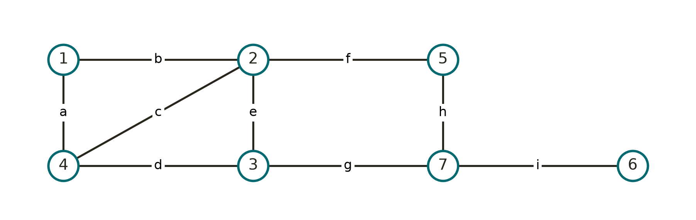
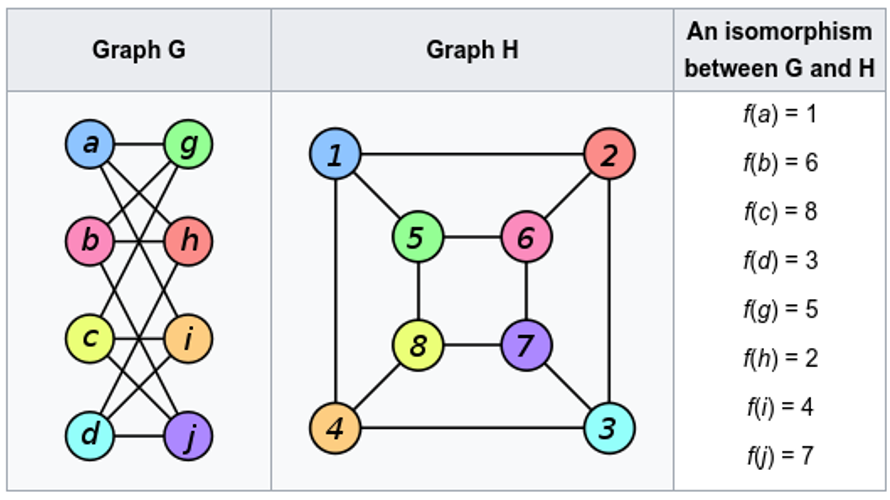
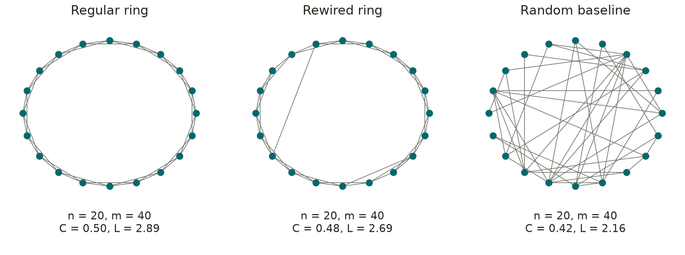

# Introduction to Network Biology

The core message is that **a network is a model of relationships, not a complete explanation of a biological system**. Keep asking what each node and edge represents, which evidence supports it, and which biological claims the representation can actually test.

With this study resource you should be able to:

- **Representation:** choose nodes, edges, direction, sign, and weights appropriate to a biological question.
- **Calculation:** construct graph matrices and calculate degree, distances, clustering, centrality, and simple modularity.
- **Interpretation:** distinguish hubs, bottlenecks, communities, and biological modules without equating topology with causation.
- **Propagation:** explain random walks with restart and contrast them with shortest-path methods.
- **Application:** describe how networks support gene prioritization, network medicine, and the S2B cross-disease analysis.
- **Critical evaluation:** identify missing context, ascertainment bias, circular validation, and inappropriate null models.

### Conventions and clarifications

Unless otherwise stated, calculations use a simple, undirected, unweighted graph without self-loops. Directed adjacency follows the convention “row = source, column = target”; some references use the transpose, so their formulas must be translated consistently.

- Closeness centrality is normally the reciprocal of mean distance;
- Eccentricity and reciprocal-eccentricity centrality are distinct;
- Eigenvector centrality depends on neighbours' centralities, not simply their degrees;
- Katz counts walks;
- K-plex requires at least, not exactly, $N-k$ neighbours.

## Network Models to answer Biological Questions

Network Biology studies how molecular components and their relationships contribute to cellular organisation and function. Protein interactions, metabolic reactions, transcriptional regulation, and signalling provide different relationship types and therefore different network representations ([Barabási and Oltvai, 2004](https://www.nature.com/articles/nrg1272)).

A useful starting point is a question, not a database download. For example: “Which proteins might connect a known disease-gene set to an RNA-processing mechanism?” This question suggests a protein-interaction representation and candidate prioritisation, but not necessarily a quantitative prediction of reaction rates.

To make such priorisation and predictions we need to have a model of the system.

### Systems Components and Interactions

To build a model for biological analysis we need to define:

- **System boundaries:** organism, cell type, compartment, condition, and time window.

And answer:

- What are the systems components and how do the interact?
  - **Nodes:** genes, proteins, isoforms, metabolites, reaction compounds, cells, or patients.
  - **Edges:** the particular biological relationship being represented.
  - **Attributes:** evidence, confidence, direction, sign, abundance, and context.

Where can we find information to our model?

- Literature
- Previous models and Pathway databases

### Resources for Models and Pathways

BioModels stores mathematical models of biological and biomedical systems, whereas pathway resources primarily organise biological knowledge into pathway representations. These are complementary starting points, not interchangeable data products ([BioModels](https://www.ebi.ac.uk/biomodels/); [KEGG PATHWAY](https://www.genome.jp/kegg/pathway.html)).

- **KEGG PATHWAY:** manually drawn maps of molecular interactions, reactions, and relations ([KEGG](https://www.genome.jp/kegg/pathway.html)).
- **Reactome:** curated, peer-reviewed pathway knowledge with visualisation and analysis tools ([Reactome](https://reactome.org/)).
- **WikiPathways:** an open, community-curated platform for pathway information ([WikiPathways](https://www.wikipathways.org/)).
- **Pathway Commons:** integration of pathway and interaction resources in BioPAX, with binary interaction exports that simplify richer source relationships ([Pathway Commons](https://www.pathwaycommons.org/)).

### Resources for Interactions and Associations

Despite their usefulness, pathway boundaries are human-defined and do not usually include recently found interactions through high-throughput methodologies.

These can be found in molecular interaction databases.

- **IntAct:** molecular interaction data curated from the literature or submitted by users; inspect record-level experimental evidence ([IntAct](https://www.ebi.ac.uk/intact/home)).
- **BioGRID:** curated protein and genetic interactions, alongside additional interaction-related datasets ([BioGRID](https://thebiogrid.org/)).
- **STRING:** known and predicted protein associations and functional-enrichment tools; association does not in every case mean direct physical binding ([STRING](https://string-db.org/)).
- **OmniPath:** integrated intracellular and intercellular signalling knowledge, including regulatory interactions, complexes, and annotations; the integrated data are not inherently tissue-specific ([OmniPath](https://omnipathdb.org/)).

**The edge definition must survive the download.** If two resources are merged, retain provenance and interaction type rather than silently treating every relationship as an identical physical contact.

### Major biological network types

| Network | Typical nodes and edges |
|---|---|
| Metabolic | Metabolites linked through reactions, or a bipartite metabolite–reaction representation |
| Protein Interaction | Proteins linked by interaction evidence |
| Transcription Regulation | Regulators linked to target genes |
| Signal Transduction | Molecular entities linked by signalling relationships |
| Genetic Interaction | Genes linked by evidence from combined perturbations |
| Co-Expression | Genes linked by expression-profile similarity |

### Static Network Models vs. Dynamic Network Models

A static network captures possible relationships, whereas dynamic network behaviour also depends on processes such as reaction kinetics and changes in molecular state. Network medicine therefore distinguishes topological descriptions from the harder task of modelling system dynamics ([Lee and Loscalzo, 2019](https://pmc.ncbi.nlm.nih.gov/articles/PMC6616999/)).

Consider the hypothetical regulatory chain $(A \rightarrow B \rightarrow C)$.

Its topology does not specify how rapidly C changes after B is perturbed. To make that prediction, a modeller must additionally choose state variables, functional relationships, parameters, and initial conditions.

### Checklist for a Reproducible Network Construction Workflow

Use the following as an analysis checklist. These are recommended design choices for an abstract workflow, not a claim that one database or threshold suits every project.

- **Specify:** define the question, organism, tissue, entity level, and relationship type.
- **Acquire:** record resource version, retrieval date, licence conditions, and original evidence fields.
- **Map identifiers:** preserve original identifiers and a mapping table; inspect one-to-many mappings.
- **Filter:** document evidence thresholds, species restrictions, and handling of self-loops.
- **Merge:** distinguish duplicate observations from distinct interaction types.
- **Retain missingness:** keep a separate list of seed genes absent from the network and of mapped isolates.
- **Audit:** report node and edge counts, component sizes, and losses at each step.
- **Test sensitivity:** repeat the main result with reasonable alternative filters and networks.

An edge list alone cannot represent isolated nodes, so preserve a node table as well.

- Keep columns for node identifier, original identifier, species, context;
- keep edge columns for source, target, type, direction, sign, confidence, and provenance.

## Networks and Graph Theory

### What is a Network? And a Graph?

A network can generally be defined as a graph; however, some authors reserve “network” for directed weighted graphs.

A **Graph** is an ordered pair $G=(V,E)$ such that $V$ is a finite set and $E$ is composed of pairs of $V$ members. The members of $V$ are denoted by **Nodes** and the members of $E$ are denoted by **Edges or Arcs**.

So the graph $G=(V,E)$, with a vertex set $(V)$ and an edge set $(E)$, has size $n=|V|$ nodes and $m=|E|$ edges ([Network Science, graph theory](https://networksciencebook.com/chapter/2)).

The following image represents a graph $G=(V,E)$ with:

$V=\{1,2,3,4,5,6,7\}$

$E=\{(1,4),(1,2),(4,2),(4,3),(2,3),(2,5),(3,7),(5,7),(7,6)\}$



The edge labels are $a=(1,4)$, $b=(1,2)$, $c=(4,2)$, $d=(4,3)$, $e=(2,3)$, $f=(2,5)$, $g=(3,7)$, $h=(5,7)$, and $i=(7,6)$. Thus, $G$ has size $n=7$ and $m=9$.

In network terminology, we use “**walk**” for an edge-following sequence that may repeat vertices and “**chain**” or “**path**” for one without repeated vertices. A **cycle** is a path that returns to its start without repeating other vertices.

Considering the previous image and that the arrows indicate traversal, not directed edges:

- **Path:** $(1 \rightarrow 2 \rightarrow 5 \rightarrow 7 \rightarrow 6)$
- **Cycle:** $(1 \rightarrow 2 \rightarrow 4 \rightarrow 1)$

A **Simple Graph** has no self-loops or parallel edges, which means that two edges cannot repeat the same endpoint pair, not that edges cannot share a node.

### Subgraphs, Components, and Isomorphism

An induced **Subgraph** of $G$ that has a subset of nodes $V_S$ retains all original edges between nodes in the subset $V_S$, while a general subgraph may omit some of those edges ([Network Science, graph theory](https://networksciencebook.com/chapter/2)). Considering the same graph example, for $V_S=\{1,2,4\}$, the induced subgraph is the triangle with edges $E_S=(a,b,c)$.

A **Connected Graph** is one in which there is a chain between every pair of nodes. If an edge removal causes the graph to lose its connectivity, it is considered a **Bridge** (removing edge $i=(7,6)$ separates node 6), while a node that, when removed, also breaks the connectivity is an **Articulation node** (removing node 7 separates node 6 from the remaining graph).

If a graph is disconnected, each connected subgraph is a **Component** of the full graph and the **main component** is the maximal connected portion of a graph, defined by node count ([Network Science, graph theory](https://networksciencebook.com/chapter/2)).

Two graphs are **Isomorphic** if one can transform one into the other by changing node identity. The following drawings show the same topology even when one graph may look circular and the other hierarchical.



### Direction and Weights

While some biological networks, such as protein physical interactions or gene co-expression networks, do not require edges to have directionality, some interactions or relations only have biological meaning in the graph if the directionality is retained. As such, we can distinguish two graph types based on directionality. In an **Undirected Graph**, an edge has no orientation, whereas in a **Directed Graph**, an edge distinguishes source and target.

Likewise, weights attach numerical values to relationships, such as confidence values, metabolic rates, or correlation coefficients. If weights are present, our model is a **Weighted Graph**, and for each node the sum of all connected edge weights is the **Node Strength**. If the graph is both directed and weighted, one direction must be defined as positive and the other negative.

The interpretation of a weight must be specified before using it in a calculation or algorithm ([Network Science, graph theory](https://networksciencebook.com/chapter/2)). Consider two hypothetical edges with confidence 0.9 and 0.2. If an algorithm minimises total weight, passing confidence directly as distance makes the low-confidence edge cheaper, which reverses the intended meaning. A transformation such as $(1/w)$ or $(-\log w)$ may be useful only when its assumptions fit the analysis.

## Graph Representations and Edge Semantics

Graphs can be represented in several different ways that are computer- and algebra-friendly.

### Adjacency Matrix vs Incidence Matrix

For an unweighted graph, its **Adjacency Matrix** is defined by $A_{ij}=1$ when the specified edge exists and $A_{ij}=0$ otherwise. For an undirected graph, the adjacency matrix is symmetric because an edge between $i$ and $j$ implies an edge between $j$ and $i$ ([Network Science, graph theory](https://networksciencebook.com/chapter/2)).

Adjacency-matrix representation is algebra-friendly: operations such as matrix multiplication can be used to count walks, identify paths of a given length, and support many network algorithms. However, it stores an entry for every possible pair of nodes. Thus, for a graph with $N$ nodes, the matrix has $N^2$ entries, so both memory use and some computations grow rapidly as the network becomes larger. This is especially inefficient for sparse real-world networks, where most node pairs are not directly connected.

For an unweighted, undirected graph, its **Incidence Matrix** is defined by $B_{ik}=1$ when node $i$ is an endpoint of edge $k$, and $B_{ik}=0$ otherwise. Each column therefore corresponds to one edge and contains exactly two 1s, indicating the two nodes connected by that edge. Incidence matrices explicitly represent node–edge relationships, making them useful for edge-oriented operations and for formulations involving flows, cuts, or incidence relationships.

Incidence-matrix representation is also intuitive for identifying which nodes participate in each edge. However, it is generally less compact than an edge list for large sparse graphs, because it requires one row per node and one column per edge. Like the adjacency matrix, its size grows with both the number of nodes and the number of edges.

Considering only four nodes from the example graph and using node order $(1,2,3,4)$, the subgraph contains edges $(a,b,c,d,e)$. Its adjacency matrix and undirected incidence matrix are:

```text
Adjacency                  Incidence
       1 2 3 4                   a b c d e
  1    0 1 0 1              1    1 1 0 0 0
  2    1 0 1 1              2    0 1 1 0 1
  3    0 1 0 1              3    0 0 0 1 1
  4    1 1 1 0              4    1 0 1 1 0
```

For example, edge $a$ connects nodes $1$ and $4$; therefore, the incidence matrix has 1s in rows 1 and 4 of column $a$. Edge $b$ connects nodes $1$ and $2$, edge $c$ connects nodes $2$ and $4$, edge $d$ connects nodes $3$ and $4$, and edge $e$ connects nodes $2$ and $3$.

### Edge and Neighbour Lists

An **edge list** is a simple collection of the graph’s edges, usually written as pairs of connected nodes. It is compact and easy to store, especially when the graph is sparse, because it records only existing connections rather than all possible node pairs.

A **neighbour list**, also called an adjacency list, records, for each node, the nodes directly connected to it. It is particularly efficient for traversing a network, finding a node’s neighbours, and performing algorithms such as breadth-first search or depth-first search.

```text
Edge List                 Neighbor List
a  1 4                    1: 2, 4
b  1 2                    2: 1, 3, 4
c  2 4                    3: 2, 4
d  3 4                    4: 1, 2, 3
e  2 3
```

In this example, node $2$ has three neighbours $(1,3,4)$ because it is directly connected to each of them. The edge list and neighbour list contain the same connectivity information, but organise it differently: the edge list is organised by edges, whereas the neighbour list is organised by nodes. The adjacency matrix represents the same graph as a dense $4 \times 4$ table, while the edge and neighbour lists avoid storing the many absent connections.

## Network Characterisation: Distances and Paths

Many network measures depend on the idea of a **path**: a sequence of connected nodes that leads from one node to another. In an unweighted graph, the length of a path is the number of edges it contains, while in a weighted graph, it is the sum of the edge weights along the path.

A **shortest path** is the path with the smallest possible length between two nodes ([NetworkX shortest paths](https://networkx.org/documentation/stable/reference/algorithms/shortest_paths.html)).

The **distance** $d(i,j)$ between nodes $i$ and $j$ is the length of their shortest path. In an unweighted graph, this is the minimum number of edges needed to travel from $i$ to $j$. In a weighted graph, it is the minimum total edge weight along a valid path; for example, if edge weights represent interaction strengths, the shortest path may depend on how those weights are interpreted ([NetworkX shortest paths](https://networkx.org/documentation/stable/reference/algorithms/shortest_paths.html)).

For an unweighted graph, the distance between two nodes can be found using breadth-first search. For weighted graphs, methods such as Dijkstra’s algorithm can find shortest paths when edge weights are non-negative. If no path connects two nodes, their distance is undefined or conventionally set to infinity.

### Network-Wide Distance Measures

Several global measures summarise distances across an entire network. They are usually calculated only within a connected component, because nodes in different components cannot reach one another.

- **Eccentricity:** For a node $i$, its eccentricity is the largest shortest-path distance from $i$ to any other node in the same connected component: $e(i)=\max_j d(i,j)$.
- **Diameter:** The diameter of a network is the largest shortest-path distance between any pair of nodes: $D=\max_{i,j} d(i,j)$. It represents the worst-case separation between two connected nodes ([NetworkX distance module](https://networkx.org/documentation/networkx-0.37/networkx.distance-module.html)).
- **Radius:** The radius is the smallest eccentricity among all nodes: $R=\min_i e(i)$. It represents the best possible worst-case distance from a node to all other nodes ([NetworkX distance module](https://networkx.org/documentation/networkx-0.37/networkx.distance-module.html)).
- **Average shortest-path length:** This is the mean shortest-path distance over all connected node pairs. It describes the typical separation between nodes in the network.
- **Centre:** The centre consists of the nodes whose eccentricity equals the network radius. These nodes are, in this sense, the most favourably positioned nodes in the network ([centre definition](https://www.baeldung.com/cs/graphs-eccentricity-radius-diameter-center-periphery)).
- **Periphery:** The periphery consists of nodes whose eccentricity equals the network diameter. These nodes are the most distant from at least one other node ([periphery definition](https://www.baeldung.com/cs/graphs-eccentricity-radius-diameter-center-periphery)).

Considering once again the first example graph, the radius is 2, the diameter is 4, and the centre nodes are $\{3,5\}$. Across the 21 unordered node pairs, distances sum to 38, giving a mean shortest-path length of $38/21\approx1.8095$.

## Network Topology

**Network topology** describes how nodes are connected, independently of what the nodes represent. In a biological network, topology can reveal whether a system is highly centralised, fragmented into modules, densely interconnected, or organised around a few highly connected hubs.

**Global topology** describes properties of the whole network, such as its density, degree distribution, clustering, path lengths, connectivity, robustness, and diffusion behaviour. **Local topology** describes properties of individual nodes or pairs of nodes, such as degree, clustering coefficient, shortest-path distance, and neighbourhood overlap. These levels are complementary: global patterns can constrain what is possible locally, while local patterns can explain why a network has a particular global organisation.

The relationship between topology and function can be viewed in either direction. Network structure may influence function; for example, a highly connected node may coordinate communication across a network. However, function can also shape network structure, because evolutionary pressures and biological requirements influence which interactions are maintained. In practice, topology should be treated as evidence that motivates a functional hypothesis, not as proof of causality.

Node-pair topology is especially useful for detecting **modules**. Measures such as shortest-path distance, neighbourhood overlap, and random walks can identify groups of nodes that are close, share neighbours, or are difficult to separate from one another. These methods support community detection and biological module discovery, but the resulting groups require biological validation.

### Node Topology: Single-Node Measures and Centrality

Node-level measures describe the position, importance, or role of an individual node within the network.

**Centrality** is not a single biological property: degree, eigenvector, closeness, betweenness, and Katz centrality quantify different structural roles ([NetworkX centrality](https://networkx.org/documentation/stable/reference/algorithms/centrality.html)). Choose the measure from the mechanism you want to investigate rather than selecting whichever produces the most interesting ranking.

#### Degree and Neighbourhood

The **degree** of a node is the number of edges connected to it. In an undirected graph, it is simply the number of node neighbours. In a directed graph, it is divided into **in-degree**, the number of incoming edges, and **out-degree**, the number of outgoing edges.

For a simple undirected graph, the degree $k_i$ is defined as $k_i=\sum_j A_{ij}$, and the sum of all degrees is twice the number of edges ([Network Science, graph theory](https://networksciencebook.com/chapter/2)).

If we define **Neighbourhood** as the set of nodes directly connected to one node, then the **Clustering coefficient** is the fraction of pairs of a node's neighbours that are themselves connected. It measures local clustering or “cliquishness” around a node.

If $T_i$ is the number of triangles containing node $i$, then the clustering coefficient can be defined as ([NetworkX clustering](https://networkx.org/documentation/stable/reference/algorithms/generated/networkx.algorithms.cluster.clustering.html)):

$$
C_i=\frac{2T_i}{k_i(k_i-1)}.
$$

Assigning $C_i=0$ for degree below 2 is the convention used by NetworkX ([NetworkX clustering](https://networkx.org/documentation/stable/reference/algorithms/generated/networkx.algorithms.cluster.clustering.html)).

For the seven-node graph example, we have:

| Node | Degree | Eccentricity | Clustering Coefficient |
|---|---:|---:|---:|
| 1 | 2 | 4 | 1 |
| 2 | 4 | 3 | 1/3 |
| 3 | 3 | 2 | 1/3 |
| 4 | 3 | 3 | 2/3 |
| 5 | 2 | 2 | 0 |
| 6 | 1 | 4 | 0 |
| 7 | 3 | 3 | 0 |

The degree sum is 18, so the mean degree is $18/7\approx2.5714$.

For node 2, the neighbours are $\{1,3,4,5\}$. Of their six possible pairs, two are linked: $(1,4)$ and $(3,4)$; hence $C_2=2/6=1/3$. For node 1, its neighbours 2 and 4 are linked, giving $C_1=1$.

The **degree centrality** of a node is its degree normalised by the maximum possible number of connections. For an undirected graph with $N$ nodes, it is:

$$
C_D(i)=\frac{k_i}{N-1}.
$$

Degree centrality rewards many immediate neighbours ([NetworkX centrality](https://networkx.org/documentation/stable/reference/algorithms/centrality.html)). In a protein–protein interaction network, such a node is often called a **hub**. However, degree alone does not indicate whether a node connects otherwise separate parts of the network.

#### Closeness Centrality

**Closeness centrality** measures how close a node is to all other reachable nodes. It is based on the sum, or average, of shortest-path distances from that node to all other nodes ([introduction to network models MIT course](https://ocw.mit.edu/courses/1-022-introduction-to-network-models-fall-2018/74fafca807f9287cffcf005dbc6ff92a_MIT1_022F18_lec4.pdf)).

For a connected undirected graph with $N$ nodes, closeness centrality is commonly defined as:

$$
C_C(i)=\frac{N-1}{\sum_{j\neq i}d(i,j)}.
$$

A node with high closeness centrality can reach other nodes through relatively short paths. It may therefore be interpreted as efficiently positioned for receiving or spreading information through the network ([network-science-notes.github](https://network-science-notes.github.io/chapters/04-centrality.html)).

Closeness centrality depends on distances, not only on direct connections. A node with few neighbours may still have high closeness if it is close to many other nodes through short paths.

For node 2 of the example graph, distances to the other six nodes sum to 9, giving closeness $6/9=2/3$.

#### Betweenness Centrality

**Betweenness centrality** measures how often a node lies on shortest paths between other pairs of nodes. It identifies nodes that may act as bridges, brokers, or bottlenecks in the network ([introduction to network models MIT course](https://ocw.mit.edu/courses/1-022-introduction-to-network-models-fall-2018/74fafca807f9287cffcf005dbc6ff92a_MIT1_022F18_lec4.pdf)).

For a node $v$, betweenness centrality is:

$$
C_B(v)=\sum_{s\neq v\neq t}
\frac{\sigma_{st}(v)}{\sigma_{st}},
$$

where $\sigma_{st}$ is the total number of shortest paths from node $s$ to node $t$, and $\sigma_{st}(v)$ is the number of those shortest paths that pass through $v$ ([NetworkX betweenness](https://networkx.org/documentation/stable/reference/algorithms/generated/networkx.algorithms.centrality.betweenness_centrality.html)).

A high-betweenness node may have relatively few direct connections but occupy an important position between different network regions. In biological networks, such nodes may be candidates for further investigation as potential connectors between functional modules, although network position alone does not prove biological importance.

In the worked graph, node 2 has maximum degree 4, but node 7 has the largest normalised betweenness, $0.3667$. All paths connecting node 6 to other nodes must cross 7, giving 7 a bottleneck role despite its lower degree.

#### Katz Centrality

**Katz centrality** measures the influence of a node by considering both its direct neighbours and nodes reachable through longer paths. Unlike degree centrality, it does not stop at immediate connections; unlike shortest-path-based measures, it accounts for multiple possible walks through the network ([Rehm et al., 2023](https://www.link.springer.com/article/10.1007/s13278-023-01135-3)).

Longer walks contribute less than shorter walks. This is controlled by an attenuation parameter, usually denoted $\alpha$, which must be chosen so that the calculation remains valid ([Rehm et al., 2023](https://www.link.springer.com/article/10.1007/s13278-023-01135-3)).

For an adjacency matrix $A$, Katz centrality can be written as:

$$
\mathbf{x}=(I-\alpha A)^{-1}\mathbf{1}-\mathbf{1},
$$

where $\mathbf{1}$ is a vector of ones. Equivalently, it sums the number of walks reaching a node, with walks of length $k$ weighted by $\alpha^k$ ([NetworkX Katz centrality](https://networkx.org/documentation/stable/reference/algorithms/generated/networkx.algorithms.centrality.katz_centrality.html)).

In a biological network, a node with high Katz centrality may be connected to important molecules both directly and through multiple indirect routes. However, its interpretation depends on the network type: in a directed regulatory network, direction matters; in an undirected protein–protein interaction network, it mainly reflects overall embedding in well-connected regions.

#### Eigenvector and PageRank Centrality

**Eigenvector centrality** considers not only how many connections a node has, but also how important its neighbours are. A node connected to other highly connected nodes receives a higher score than a node connected mainly to low-degree nodes.

**PageRank** is a related measure originally developed for web pages. It assigns importance to a node based on the importance and number of nodes linking to it. In a biological network, these measures can help highlight nodes that are embedded in influential or well-connected regions, but their interpretation depends on the meaning assigned to edges.

### Node-Pair Topology: Relationships Between Nodes

Node-pair measures describe the relationship between two specific nodes. They are useful for assessing whether two genes or proteins are close, connected through shared partners, or likely to participate in the same biological process.

#### Path-Based Node-Pair Measures

Beyond the shortest path, node pairs can be characterised by:

- **Number of shortest paths:** Some node pairs are connected by more than one shortest path. Multiple shortest paths may indicate alternative routes through the network.
- **Number of paths of a given length:** This can describe how many routes of a particular length connect two nodes.
- **Network proximity:** A measure of whether two nodes, or two groups of nodes, are closer in the network than expected by chance.
- **Reachability:** Whether one node can reach another through a sequence of edges.

These measures can support hypotheses about shared biology. For example, two proteins that are close in an interaction network and share several neighbours may be prioritised for experimental validation, but neither proximity nor shared neighbours establishes a direct causal relationship.

#### Common Neighbours and Jaccard Similarity

Two nodes may be related even when they are not directly connected. **Common neighbours** are nodes connected to both nodes in a pair. In a protein–protein interaction network, two proteins with many shared interactors may participate in related processes.

The **Jaccard similarity** compares the neighbourhoods of two nodes:

$$
J(i,j)=\frac{|N(i)\cap N(j)|}{|N(i)\cup N(j)|}.
$$

Here, $N(i)$ and $N(j)$ are the neighbour sets of nodes $i$ and $j$. A value of 1 means that the two nodes have identical neighbourhoods, whereas a value of 0 means that they share no neighbours.

Using open neighbourhoods in the worked graph, $N(1)=\{2,4\}$ and $N(3)=\{2,4,7\}$, so $J(1,3)=2/3$. This is a teaching definition: “matching index” is not a guarantee that every software package uses this exact denominator.

#### Topological Overlap and Matching Index

**Topological overlap**, also called the **matching index**, measures how similar the neighbourhoods of two nodes are. It is particularly useful when two nodes are not directly connected but share many interaction partners.

A simple matching index for nodes $i$ and $j$ is:

$$
M(i,j)=\frac{|N(i)\cap N(j)|}{|N(i)\cup N(j)|},
$$

where $N(i)$ and $N(j)$ are the neighbour sets of the two nodes. A value of 1 means that the nodes have identical neighbourhoods, while a value of 0 means that they share no neighbours.

In a gene co-expression network, high topological overlap may suggest that two genes are connected to a similar set of genes and may therefore participate in a related biological process. In a protein–protein interaction network, it may suggest that two proteins have similar interaction partners. However, this is a hypothesis about functional similarity, not proof that the two proteins interact directly or perform the same function.

Topological overlap is a **node-pair** measure because its value is defined for a pair of nodes. It can also be used as input to clustering: nodes with high mutual topological overlap may be grouped together during community detection.

Topological overlap is not one universal formula. For a nonnegative, symmetric adjacency with zero diagonal in the sums, a common minimum-denominator topological overlap measure is ([WGCNA documentation](https://search.r-project.org/CRAN/refmans/WGCNA/html/TOMsimilarityFromExpr.html)):

$$
\mathrm{TOM}_{ij}=
\frac{\sum_{u\ne i,j}A_{iu}A_{uj}+A_{ij}}
{\min(k_i,k_j)+1-A_{ij}}.
$$

The shared-neighbour term and direct adjacency both contribute; WGCNA also documents alternative denominator and signed variants ([WGCNA documentation](https://search.r-project.org/CRAN/refmans/WGCNA/html/TOMsimilarityFromExpr.html)). Consequently, TOM and Jaccard should not be used interchangeably without stating the formula.

For nodes 1 and 3, the numerator is 2 and the denominator is $2+1=3$, so TOM also happens to be $2/3$. For adjacent nodes 1 and 2, Jaccard is $1/5$, but TOM is $(1+1)/(2+1-1)=1$; the measures now differ strongly.

#### Node Cuts and Edge Cuts

A local edge cut removes edges to break all connections between a selected pair; a local vertex cut removes intermediate vertices, excluding the selected endpoints ([NetworkX node connectivity](https://networkx.org/documentation/stable/reference/algorithms/generated/networkx.algorithms.connectivity.connectivity.node_connectivity.html)). For nonadjacent endpoints, the minimum sizes quantify local edge and vertex connectivity; adjacent endpoints require careful conventions for vertex cuts.

Between nodes 1 and 6, edge connectivity is 1 because deleting $(7,6)$ disconnects them. Vertex connectivity is also 1 because deleting node 7 suffices.

Between nodes 1 and 3, paths $1\!-\!2\!-\!3$ and $1\!-\!4\!-\!3$ have no shared internal node. Removing both 2 and 4 disconnects the pair, so their local vertex connectivity is 2.

**Biological interpretation:** Redundant topological routes suggest alternative connections worth testing, not proof that equivalent biochemical compensation exists. Formulate the corresponding perturbation experiment before calling the alternatives functionally redundant.

#### Random Walk with Restart

**Random walk with restart (RWR)** starts from one or more seed nodes and repeatedly moves to a neighbouring node. At each step, the walker either moves along an edge or returns to the seed set with a fixed probability ([nature](https://www.nature.com/articles/s42005-022-00937-9)).

The result is a score for every node in the network, expressing its proximity to the seed nodes. Nodes that are directly connected to the seed, or connected through multiple short and well-supported paths, generally receive higher scores ([nature](https://www.nature.com/articles/s42005-022-00937-9)).

RWR is therefore primarily a **node-pair** or **seed-to-node** measure. It quantifies the relationship between a specified seed node and every other node. It can be used, for example, to prioritise genes or proteins close to a known disease-associated seed set.

RWR is closely related to **personalised PageRank**. The distinction is that ordinary PageRank uses a global restart distribution, whereas RWR uses a specific seed node or seed set as the restart target ([nature](https://www.nature.com/articles/s42005-022-00937-9)).

### Network-Level Properties: Connectivity, Diffusion, and Robustness

Network-level properties describe the organisation, resilience, and behaviour of the graph as a whole. They complement node-level and node-pair measures by asking how the entire system is connected, how easily it can be disrupted, and how information or perturbations may spread through it.

#### Node and Edge Connectivity

**Node connectivity** and **edge connectivity** describe the robustness of a network against disconnection. They are network-level properties, rather than node-level or node-pair measures, because they concern the minimum number of elements whose removal would break the network into separate components.

- **Node connectivity**, $\kappa(G)$, is the minimum number of nodes that must be removed to disconnect the graph or reduce it to a single node.
- **Edge connectivity**, $\lambda(G)$, is the minimum number of edges that must be removed to disconnect the graph.

For example, if removing two proteins is sufficient to separate a connected interaction network into disconnected components, its node connectivity is at most 2. These measures can help identify structurally vulnerable parts of a network, but they should not be interpreted as direct measures of biological essentiality.

In the worked graph, removing node 7 disconnects node 6, whereas removing the highest-degree node 2 leaves all remaining nodes connected. This illustrates that the most connected node is not necessarily the node whose removal most disrupts connectivity.

#### Network Diffusion

**Network diffusion** models how something spreads through a network over time. Depending on the application, the spreading quantity may represent information, probability, a molecular signal, a disease-associated score, or a perturbation.

A diffusion process typically starts with an initial value or probability assigned to one or more seed nodes. At each step, some of that value moves to neighbouring nodes according to the network structure and chosen diffusion rule. Repeating the process produces a distribution across the network.

Random walk with restart can be viewed as a diffusion process that reaches a steady state: probability mass spreads from the seed nodes through the network, while a fraction continuously returns to the seeds. Thus, RWR is a specific diffusion-based method, whereas “network diffusion” is the broader concept ([Batista and colleagues, 2022](https://www.nature.com/articles/s42005-022-00937-9)).

In network medicine, diffusion-based methods can propagate evidence from known disease genes to other genes in an interaction network. The resulting scores can prioritise candidate genes or proteins for further study, but they remain hypotheses rather than proof of causal involvement.

#### Network Models and Structural Organisation

Network models provide simplified mathematical descriptions of how networks may be organised. They can help explain observed properties such as the distribution of node degrees, the presence of hubs, short average path lengths, and high local clustering.

Four useful structural ideas are:

- **Random baseline:** In the simple $G(n,p)$ model, each possible undirected edge is independently present with probability $p$, yielding an expected degree of $(n-1)p$.
- **Scale-free hypothesis:** A degree-distribution tail follows $P(k)\propto k^{-\gamma}$, so high-degree nodes occur more frequently than in a narrow degree distribution ([Broido and Clauset, 2019](https://www.nature.com/articles/s41467-019-08746-5)).
- **Hierarchical organisation:** Modules can be nested within larger modules; an idealised example associates this with clustering that decreases as degree increases.
- **Small-world organisation:** Relatively high clustering coexists with short characteristic path length relative to suitable random counterparts.



These three original simulations illustrate a regular-to-random progression. Their node and edge counts match; the diagrams are not biological evidence and the small sample is not a statistical test.

#### Small-World Organisation

A **small-world network** combines relatively short average path lengths with high local clustering. In biological terms, this may mean that most molecules are separated by only a small number of interactions, even though the network contains many local, densely connected groups.

The statement is comparative: a small-world network retains local clustering while acquiring short routes through shortcuts. Before applying that label in research, specify the null model, match relevant network properties, and check how disconnected components are handled.

Short paths alone do not establish biological signalling speed. To test that interpretation, combine topology with a model or measurements of delays, direction, molecular state, and context.

#### Robustness

**Robustness** describes how a network maintains its structure or function when nodes or edges are removed. Networks with highly connected hubs may be vulnerable to targeted removal of those hubs, whereas networks with a more distributed structure may be more resilient to random failures.

To study robustness, choose both a perturbation and an outcome: random versus targeted removals, and retained connectivity versus retained biological function. These ideas can generate hypotheses about network vulnerability, but they do not by themselves predict biological or clinical outcomes.

#### Do Not Infer a Power Law from Hubs

A network can have hubs without having a power-law degree distribution, and a visually straight line on log–log axes is not sufficient evidence ([Broido and Clauset, 2019](https://www.nature.com/articles/s41467-019-08746-5)). Statistical fitting, a defensible tail cutoff, goodness-of-fit assessment, and comparison with alternatives such as log-normal distributions are needed before claiming a scale-free pattern ([Broido and Clauset, 2019](https://www.nature.com/articles/s41467-019-08746-5)).

The early network-biology review emphasised shared architectural principles, but later broad empirical testing showed that strong scale-free evidence is far from universal ([Barabási and Oltvai, 2004](https://www.nature.com/articles/nrg1272); [Broido and Clauset, 2019](https://www.nature.com/articles/s41467-019-08746-5)). These notes therefore retain scale-free networks as a useful model without treating every cellular network as scale-free.

## Communities and Biological Modules

In networks, **community detection** and **clustering** are used to identify groups of nodes that are more strongly connected to one another than to the rest of the network.

In biological networks, these groups may correspond to biological modules. For example, a densely connected group of proteins may represent a protein complex, a signalling pathway, a set of co-expressed genes, or proteins involved in a shared cellular process. However, a dense network group is only a computational pattern: its biological meaning must be established using external evidence, such as gene ontology annotations, pathway databases, experimental data, or prior literature.

**Community detection** seeks the organisation of a network into groups, whereas **biological interpretation** asks what those groups mean. A detected community is not automatically a biological pathway or functional module; it is a hypothesis that requires validation.

### Communities and Dense Subgraphs

A **community** is a set of nodes grouped under a chosen objective, often because its members have many connections among themselves relative to what would be expected by chance. In an unweighted graph, this can be expressed as dense internal connectivity relative to a null model ([NetworkX modularity](https://networkx.org/documentation/stable/reference/algorithms/generated/networkx.algorithms.community.quality.modularity.html)).

Dense subgraphs can suggest functional relatedness. In a protein–protein interaction network, for example, a highly interconnected group of proteins may indicate a protein complex or a set of proteins that participate in the same cellular process. Still, dense connectivity alone does not prove a shared function; it provides a biological hypothesis to investigate.

Several related terms describe dense or cohesive groups:

- **Clique:** A subgraph in which every pair of distinct nodes is directly connected. A **maximal clique** cannot be enlarged without losing this property, whereas the **maximum clique** is the largest clique in the graph.
- **$k$-plex or Quasi-clique:** A relaxed clique in which each of the $s$ selected nodes must have at least $s-k$ neighbours within the selected set. Thus, each node may miss at most $k-1$ connections to other selected nodes; a 1-plex is a clique ([k-plex definition](https://ar5iv.labs.arxiv.org/html/2202.08737)).
- **$k$-core:** A maximal subgraph in which every node has degree at least $k$ within that subgraph. The degree is assessed within the subgraph, not merely in the original network ([NetworkX k-core](https://networkx.org/documentation/stable/reference/algorithms/generated/networkx.algorithms.core.k_core.html)).

For the example graph, $\{1,2,4\}$ and $\{2,3,4\}$ are maximal cliques: each contains three nodes, and every pair of nodes within each set is connected. Iteratively deleting nodes with degree below 2 removes node 6 and leaves the 2-core $\{1,2,3,4,5,7\}$. This remaining subgraph is a 2-core because every node has at least two neighbours within it, but it is not a clique because not every pair of nodes is directly connected.

### Modularity Measures a Partition

**Modularity** is a score used to evaluate how well a proposed partition divides a network into communities. It compares the number of edges observed within groups with the number that would be expected if edges were distributed according to a degree-preserving null model ([NetworkX modularity](https://networkx.org/documentation/stable/reference/algorithms/generated/networkx.algorithms.community.quality.modularity.html)).

For an undirected, unweighted graph and resolution parameter $\gamma=1$, modularity is:

$$
Q=\frac{1}{2m}\sum_{ij}
\left(A_{ij}-\frac{k_i k_j}{2m}\right)\delta(c_i,c_j).
$$

Here, $m$ is the number of edges, $A_{ij}$ is the adjacency matrix entry, $k_i$ and $k_j$ are the degrees of nodes $i$ and $j$, and $\delta(c_i,c_j)$ equals 1 when nodes $i$ and $j$ belong to the same community and 0 otherwise. The degree-based term provides the expected number of connections under the null model ([NetworkX modularity](https://networkx.org/documentation/stable/reference/algorithms/generated/networkx.algorithms.community.quality.modularity.html)).

For the partition $\{1,2,3,4\}\mid\{5,6,7\}$, the internal edge counts are 5 and 2, and the degree sums are 12 and 6. Therefore:

$$
Q=\left(\frac{5}{9}-\left(\frac{12}{18}\right)^2\right)
+\left(\frac{2}{9}-\left(\frac{6}{18}\right)^2\right)=\frac{2}{9}.
$$

A positive modularity value means that the proposed groups contain more internal edges than expected under the null model. However, the score describes the proposed partition; it does not establish that the two groups are genuine biological pathways. Changing the resolution parameter changes the preferred scale of grouping: values below 1 tend to favour larger communities, whereas values above 1 tend to favour smaller communities ([NetworkX modularity](https://networkx.org/documentation/stable/reference/algorithms/generated/networkx.algorithms.community.quality.modularity.html)).

### How Communities Are Detected

There is no single universal method for detecting communities. Different algorithms define “community” differently and may produce different partitions for the same network. The appropriate method depends on the biological question, the type of network, and whether the goal is to find overlapping groups, hierarchical structure, or a single partition.

#### Distance-Based Clustering

One approach is to define a distance or similarity between nodes and apply a clustering method. For example, two proteins may be considered similar if they share many interaction partners, have similar expression profiles, or are close in the network.

A distance-based clustering algorithm then groups nodes with small distances or high similarity. This can reveal groups of genes or proteins with related functions, but the result depends strongly on the chosen distance measure and clustering parameters.

#### Agglomerative Modularity Optimisation

A second approach begins with each node in its own group and repeatedly merges groups that produce the greatest improvement in modularity. This is a **stepwise agglomerative algorithm**: it starts from many small communities and combines them progressively.

At each step, the algorithm evaluates possible merges and selects the one that maximises modularity. The process continues until no further merge improves the score. This type of approach can efficiently identify community structure in large networks, but it may return a local rather than global optimum, meaning that a different starting condition or algorithm could produce a different partition.

#### Edge Betweenness Removal

A third approach identifies edges that connect different parts of the network and removes them one at a time. **Edge betweenness** measures how frequently an edge lies on shortest paths between pairs of nodes.

Edges with high betweenness often act as bridges between densely connected regions. The **Girvan–Newman** method repeatedly removes the edge with the highest betweenness, recalculates betweenness after each removal, and thereby progressively separates the network into smaller groups. This produces a hierarchy of possible partitions, from one large community to many small communities.

### Interpreting Biological Modules

After communities are detected, the next step is biological interpretation. A community may be examined for:

- Enrichment of known biological pathways or gene ontology terms.
- Shared functions, cellular localisation, or disease associations.
- Overlap with known protein complexes or regulatory modules.
- Consistency across independent datasets or experimental conditions.
- Whether its member nodes are supported by additional evidence beyond network connectivity.

It is important to distinguish the mathematical result from the biological claim. A detected community is a **network-derived grouping**; a biological module is a grouping for which there is additional evidence that its members participate in a shared function or process. Community detection can therefore prioritise biological modules for further investigation, but it does not by itself establish their function.

## From Network Biology to Network Medicine

Network Medicine combines principles and approaches from network sciences, systems biology, and human dynamics to understand the causes of human diseases and develop new treatments ([Network Medicine Institute & Global Alliance](https://network-medicine.com)).

### Disease as a Network Perturbation

Network medicine investigates how interacting molecular systems contribute to disease phenotypes, rather than assuming every disease can be understood from one isolated gene ([Lee and Loscalzo, 2019](https://pmc.ncbi.nlm.nih.gov/articles/PMC6616999/)). The disease-module hypothesis proposes that associated genes tend to occupy interacting neighbourhoods, but both the interactome and known disease-gene sets are incomplete ([Lee and Loscalzo, 2019](https://pmc.ncbi.nlm.nih.gov/articles/PMC6616999/)).

Two perturbation models are especially useful:

- **Node perturbation:** loss or alteration of a molecular component or its abundance ([Lee and Loscalzo, 2019](https://pmc.ncbi.nlm.nih.gov/articles/PMC6616999/)).
- **Edgetic perturbation:** alteration of particular interactions while other relationships of the same component may remain intact ([Lee and Loscalzo, 2019](https://pmc.ncbi.nlm.nih.gov/articles/PMC6616999/)).

A hypothetical protein may bind partners A, B, and C, while a variant disrupts only its binding to B. Deleting the entire protein node would erase the preserved A and C relationships and therefore represent a different perturbation.

### What Can Networks Help Predict?

Biological networks help predict **which molecules, interactions, and biological processes may be relevant to a disease** by interpreting individual measurements in the context of their connections. The underlying idea is that genes or proteins contributing to the same phenotype often interact or participate in related processes, so their network relationships provide information beyond analysing each molecule separately ([Cowen and colleagues, 2017](https://link.springer.com/article/10.1038/nrg.2017.38)).

Applications include:

- **Prioritising candidate disease genes:** Genes connected to known disease-associated genes can be ranked for further investigation, including candidates whose individual genetic associations are weak but supported by their network context ([Cowen and colleagues, 2017](https://link.springer.com/article/10.1038/nrg.2017.38)).
- **Identifying disease modules:** Network analysis can reveal groups of interacting genes or proteins whose alterations collectively implicate a disease-related process, pathway, or protein complex ([Cowen and colleagues, 2017](https://link.springer.com/article/10.1038/nrg.2017.38)).
- **Predicting molecular functions:** The functions of poorly characterised genes or proteins can be inferred from their relationships with better-characterised network members ([Cowen and colleagues, 2017](https://link.springer.com/article/10.1038/nrg.2017.38)).
- **Proposing drug targets:** Integrating molecular alterations with network relationships can highlight candidate intervention points that might influence disease-associated processes ([Cowen and colleagues, 2017](https://link.springer.com/article/10.1038/nrg.2017.38)).
- **Relating different diseases:** Overlapping or nearby disease modules can suggest shared molecular mechanisms, even when the diseases do not share known disease-associated genes ([Lee and Loscalzo, 2019](https://pmc.ncbi.nlm.nih.gov/articles/PMC6616999/)).
- **Identifying patient subgroups:** Network-based integration of molecular and clinical measurements can reveal groups of patients with similar underlying biology, potentially supporting more precise disease classification and risk stratification ([Lee and Loscalzo, 2019](https://pmc.ncbi.nlm.nih.gov/articles/PMC6616999/)).

One approach is **network propagation**, which starts with known disease-associated genes or molecular scores and spreads that information mathematically through the network to rank other genes. This is an analytical procedure—not necessarily a simulation of physical signalling—and it allows candidates to receive support from both direct neighbours and broader network relationships ([Cowen and colleagues, 2017](https://link.springer.com/article/10.1038/nrg.2017.38)).

**These predictions generate hypotheses rather than establish causation or clinical effectiveness.** Network proximity does not prove that a candidate causes disease, and a predicted drug target is not automatically an effective or safe treatment; incomplete interaction data, research biases, and tissue-specific biology can all affect the interpretation ([Lee and Loscalzo, 2019](https://pmc.ncbi.nlm.nih.gov/articles/PMC6616999/)).

### Networks of Networks and Reticulotypes

Complex diseases are rarely explained by a single altered gene, protein, or pathway. Instead, biological systems are interconnected: changes in DNA, gene expression, proteins, metabolites, the microbiome, environmental exposures, and clinical measurements can influence one another. A **network of networks** is an integrative framework that represents these different levels as connected layers, so that a change in one layer can be interpreted in the context of the others ([Lee and Loscalzo, 2019](https://pmc.ncbi.nlm.nih.gov/articles/PMC6616999/)).

For example, a genetic variant may affect the expression of a gene; altered gene expression may change protein abundance or activity; altered proteins may modify metabolic reactions; and these molecular changes may ultimately contribute to a clinical phenotype. Environmental factors and the microbiome can also influence these processes. Integrating genomic, transcriptomic, proteomic, metabolic, psychosocial, and clinical data therefore helps explain why patients with broadly similar diagnoses may have different molecular mechanisms, symptoms, disease progression, and treatment responses ([Lee and Loscalzo, 2019](https://pmc.ncbi.nlm.nih.gov/articles/PMC6616999/)).

This approach is motivated by the observation that biological systems show extensive **cross-talk**: a perturbation in one molecular or physiological domain often produces changes in other domains. Rather than treating each data type separately, network-based integration aims to identify the combined pattern of alterations associated with a disease state ([Lee and Loscalzo, 2019](https://pmc.ncbi.nlm.nih.gov/articles/PMC6616999/)).

A **reticulotype** describes the patient-specific pattern of molecular alterations considered within an individualised network context. It provides a conceptual link between genotype and phenotype: rather than asking only which genetic variants or molecular measurements a patient has, it asks how those measurements are connected and how their relationships may produce a particular biological or clinical state ([Lee and Loscalzo, 2019](https://pmc.ncbi.nlm.nih.gov/articles/PMC6616999/)).

In practice, constructing a reticulotype would involve collecting multiple types of patient data, mapping the relevant molecules and clinical features into a network, identifying the altered subnetwork, and interpreting its structure in relation to the patient’s phenotype. This individualised network could then support the selection of therapies targeting key nodes or interactions, rather than relying only on population-level disease categories ([Lee and Loscalzo, 2019](https://pmc.ncbi.nlm.nih.gov/articles/PMC6616999/)).

However, a reticulotype is a research framework rather than a complete or routinely available clinical model. Current molecular networks are incomplete, and a person’s full interactome cannot yet be reconstructed from routine clinical data alone. Important limitations include tissue specificity, protein isoforms, missing or uncertain interactions, dynamic changes over time, and the lack of fully standardised methods for integrating heterogeneous multi-omic datasets ([Lee and Loscalzo, 2019](https://pmc.ncbi.nlm.nih.gov/articles/PMC6616999/)).

Protein–protein interaction data, for example, are incomplete and may be biased towards well-studied proteins; gene-regulatory networks can be difficult to infer because correlation does not necessarily indicate direct regulation; and epigenetic and post-translational modifications add further context-dependent complexity. These limitations mean that network-based interpretations should be treated as hypotheses to be validated, rather than as definitive explanations of disease ([Lee and Loscalzo, 2019](https://pmc.ncbi.nlm.nih.gov/articles/PMC6616999/)).
